# Aegis Growth OS — Cognitive AI Brain Map & Systems Topology

```
                  ┌────────────────────────────────────────────────────────┐
                  │                 AEGIS COGNITIVE CORTEX                 │
                  │        Autonomous Infrastructure Orchestration Engine  │
                  └───────────────────────────┬────────────────────────────┘
                                              │
         ┌────────────────────────────────────┼────────────────────────────────────┐
         │                                    │                                    │
         ▼                                    ▼                                    ▼
  ┌──────────────┐                     ┌──────────────┐                     ┌──────────────┐
  │  PERCEPTION  │                     │    MEMORY    │                     │  REASONING   │
  │    LAYER     │                     │   SYSTEMS    │                     │   ENGINES    │
  └──────┬───────┘                     └──────┬───────┘                     └──────┬───────┘
         │                                    │                                    │
         └────────────────────────────────────┼────────────────────────────────────┘
                                              │
         ┌────────────────────────────────────┴────────────────────────────────────┐
         │                                                                         │
         ▼                                                                         ▼
  ┌──────────────┐                                                          ┌──────────────┐
  │   EFFECTOR   │                                                          │  GOVERNANCE  │
  │    LAYER     │                                                          │   & SAFETY   │
  └──────────────┘                                                          └──────────────┘
```

---

## 1. Cognitive Architecture Overview

Aegis Growth OS is structured as a closed-loop biological cognitive agent:
1. **Perception**: Continually monitors the outside world (AI engines, search engines, inbound HTTP traffic, and user actions).
2. **Memory**: Stores telemetry, episodic semantic knowledge, session contexts, and encrypted credentials.
3. **Reasoning**: Evaluates competitive threats, prompt permutations, bayesian conversion lift, and visibility drops.
4. **Action (Effectors)**: Modifies edge HTML, native CMS databases, CRM contact profiles, Google Ads budgets, and Git codebases.
5. **Governance**: Acts as an immune system, scrubbing PII, enforcing GDPR/CCPA suppression, and eliminating hallucinations.

---

## 2. Mermaid AI Brain Map

```mermaid
graph TD
    subgraph SENSORY_PERCEPTION["1. SENSORY & PERCEPTION LAYER"]
        P1["Playwright Stealth Worker Cluster<br>(Anti-Fingerprinting, Residential Proxies)"]
        P2["AI Engine Citation Sweeper<br>(Perplexity, ChatGPT, Claude, Gemini)"]
        P3["Inbound Referrer & Intent Interceptor<br>(Referer Header, UTMs, aegis_intent)"]
        P4["Google Search Console OAuth Handshake<br>(Search Analytics API, Clickstream)"]
        P5["AXO Machine Browser Simulator<br>(Headless Agent Journey Telemetry)"]
    end

    subgraph MEMORY_SYSTEMS["2. MULTI-TIER MEMORY SYSTEMS"]
        M1["Short-Term Working Memory<br>(Redis 7.2 Session Cache, BullMQ Queues)"]
        M2["Episodic Knowledge Store<br>(pgvector 1536d Embeddings, HNSW Cosine Index)"]
        M3["Long-Term Time-Series Datastore<br>(TimescaleDB Hypertables, 14-Day Columnar Compaction)"]
        M4["Cryptographic Vault<br>(AES-256-GCM Key Store & Vault Secrets)"]
    end

    subgraph REASONING_ENGINE["3. COGNITIVE REASONING & DECISION ENGINE"]
        R1["Combinatorial Prompt Compiler<br>(Intent Prefixes × Keywords × Locations)"]
        R2["Co-Citation Matrix & Proximity Analyzer<br>(Semantic Distance, Sentiment Differentials)"]
        R3["Smart RTB Ad Position Guard<br>(Share of Voice &lt; 40% Alert Trigger)"]
        R4["Bayesian A/B Conversion Engine<br>(Thompson Sampling, Variant Confidence)"]
        R5["AXO DOM Remediation Engine<br>(Zero-CLS Heuristics, Accessibility Repair)"]
    end

    subgraph EFFECTOR_ACTION["4. ACTION & EFFECTOR SUBSYSTEMS"]
        E1["Sub-5ms Edge Rewriter<br>(Cloudflare HTMLRewriter, Next.js Vercel Edge)"]
        E2["Shopify GraphQL Metafields Sync<br>(metafieldsUpsert Mutation Loop)"]
        E3["WordPress Native Database Hook<br>(wp_insert_post_data, wp_head Injector)"]
        E4["Autonomous CRM Sales Sequencer<br>(HubSpot / Salesforce Battlecard Injection)"]
        E5["Self-Healing GitHub PR Generator<br>(Octokit Branch & Pull Request Bot)"]
        E6["Programmatic Ad Mutation Gateway<br>(Google Ads API, Meta Graph Retargeting)"]
    end

    subgraph GOVERNANCE_SAFETY["5. GOVERNANCE & IMMUNE SYSTEM"]
        G1["PII & Secret Sanitization Guard<br>(Deterministic Regex & Entropy Scrubbing)"]
        G2["Regulatory Fire-Break<br>(GDPR Explicit Consent, CCPA, Suppression Lists)"]
        G3["Factuality & Hallucination Sentinel<br>(Cross-references Vector Embeddings)"]
    end

    %% Perception to Memory
    P1 --> M3
    P2 --> M3
    P3 --> M1
    P4 --> M3
    P5 --> M3

    %% Memory to Reasoning
    M2 --> R5
    M3 --> R2
    M3 --> R3
    M1 --> R4
    R1 --> P2

    %% Reasoning to Governance to Effectors
    R2 --> R3
    R2 --> E4
    R3 --> G2
    G2 --> E6
    R5 --> G3
    G3 --> E1
    G3 --> E2
    G3 --> E3
    G3 --> E5
    R4 --> E1
```



---

## 3. Cognitive Subsystem Deep-Dive

### A. Perception Subsystem
* **Playwright Stealth Clusters**: Simulates autonomous user agents. Operates headlessly with WebGL vendor masking, dynamic viewport randomization, and residential proxy rotation to bypass Cloudflare/Akamai bot gates.
* **AI Search Citation Radar**: Dispatches synthetic prompt arrays against Perplexity AI, OpenAI ChatGPT Search, Google Gemini, and Claude to map real-time brand citations, sources, and co-mentions.
* **Universal DOM Intent Interceptor**: A `<10kb` zero-dependency script mounted in the host `<head>` that intercepts visitors arriving from AI platforms, extracting intent keywords even when browsers enforce strict HTTP referrer stripping.

### B. Multi-Tier Memory Subsystem
* **Working Memory (Redis 7.2)**: Maintains millisecond session states, active A/B test variant allocations, and task dispatching queues via BullMQ.
* **Episodic Vector Memory (PostgreSQL + pgvector)**: Partitions website content, technical specifications, and FAQs into semantic markdown chunks and computes 1536-dimensional normalized vectors with HNSW indexing for `<10ms` fact retrieval.
* **Historical Time-Series Telemetry (TimescaleDB Hypertables)**:
  * `generative_visibility_metrics`: Tracks traditional clicks vs AI citations across daily buckets.
  * `co_citation_matrix_ts`: Stores competitor proximity distances and sentiment differentials, automatically compressed into columnar format after 14 days.
* **Cryptographic Vault**: AES-256-GCM authenticated cipher store with PBKDF2 key derivation and random 96-bit initialization vectors.

### C. Cognitive Reasoning Subsystem
* **Synthetic Prompt Compiler**: Generates thousands of permutations combining intent phrases, commercial topics, and target geographic hubs.
* **Co-Citation Topology Engine**: Calculates Euclidean and topological proximity between your brand and competitors. Computes a dynamic threat tier based on reciprocal citation weight.
* **Programmatic Smart RTB Ad Guard**: Constantly evaluates Share of Voice (SoV). If AI visibility drops below the **40.0%** safety threshold, it mutates Google Ads PPC and Meta retargeting budgets in real-time.
* **Bayesian A/B Lift Model**: Employs Bayesian multi-armed bandit allocation to funnel traffic to highest-converting personalizations without sample-size lag.

### D. Action & Effector Subsystem
* **Edge Stream Rewriter**: Modifies HTML streams at the edge in `<5ms` via Cloudflare `HTMLRewriter`, completely bypassing origin server delays and eliminating visual layout shifts.
* **Shopify GraphQL Metafield Synchronizer**: Updates Shopify Metafields [2.0 framework] natively using atomic `metafieldsUpsert` mutations, preserving theme layouts.
* **WordPress Hook Middleware**: Bypasses unstable REST theme overwrites by filtering core database queries directly on `wp_insert_post_data` using HMAC-signed AST payloads.
* **Autonomous CRM Enrichment**: Automatically generates context-aware competitive battlecards and patches contact records in HubSpot/Salesforce for inbound zero-click leads.
* **Self-Healing GitHub PR Bot**: Automatically opens tested, isolated Pull Requests with verified JSON-LD schema or accessibility fixes.

### E. Governance & Immune System
* **Regulatory Compliance Fire-Break**: Rejects non-compliant outbound drips under GDPR Art. 6/7, honors global opt-out suppression registries, and maintains immutable compliance audit traces.
* **Hallucination Sentinel**: Audits AI agent outputs against verified pgvector ground-truth chunks to eliminate inaccurate claims or hallucinated pricing.
